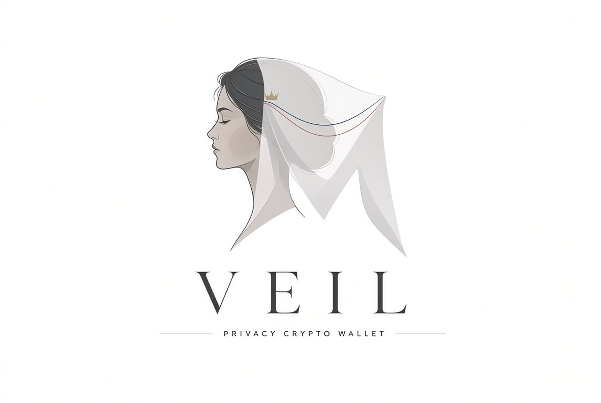

  

# Veil

Veil is a hot Monero wallet for desktop (Windows, Linux) and Android. It does
four things: create a wallet, restore a wallet, receive, and send. All network
traffic goes through a built-in Tor client, and every incoming payment gets a
fresh address.

> **Status: pre-alpha.** The embedded Tor component, the wallet core, and
> the piece that joins them exist and are tested on a private test chain. A
> command-line tool creates, restores, synchronises, and sends on the Monero
> stagenet through Tor. There is no app yet. Do not use anything here with
> real funds. Read the [disclaimer](DISCLAIMER.md).

## Priorities

1. **Reliability.** Transactions and cryptography come from the official
   Monero wallet library. Veil does not implement its own.
2. **Simplicity.** Few screens, few settings. Safe behaviour is the default
   and cannot be switched off.
3. **Anonymity.** Tor only, with no fallback to a direct connection. No
   analytics, no crash reports, no third-party services.

## What it will do

| Operation | How |
|---|---|
| Create a wallet | A 16-word recovery phrase, shown once and then verified |
| Restore a wallet | From a 16-word or a classic 25-word Monero phrase |
| Receive | A new subaddress for every incoming payment, as text and QR |
| Send | Address, amount, a review screen, then broadcast over a separate Tor circuit |

## Planned stack

| Layer | Choice |
|---|---|
| Wallet logic and cryptography | The official Monero `wallet2` library, through the `monero_c` FFI wrapper |
| Tor | Arti, embedded in the app process, with bridge support |
| User interface | Flutter, one codebase for Android, Windows, and Linux |

## Documentation

- [Concept](docs/concept.md): what Veil is and how it protects the user
- [Design](docs/design.md): visual language and screens
- [Development](docs/development.md): how the code is written, tested, and released
- [Disclaimer](DISCLAIMER.md)

## License

Veil's own code is under the [MIT License](LICENSE). The Monero wallet
library it loads at run time has its own licences; see
[native/wallet_lib](native/wallet_lib/README.md).

## Notices

Veil is an independent project and is not affiliated with the Monero Project
or The Tor Project.

This product is produced independently from the Tor® anonymity software and
carries no guarantee from The Tor Project about quality, suitability or
anything else.
