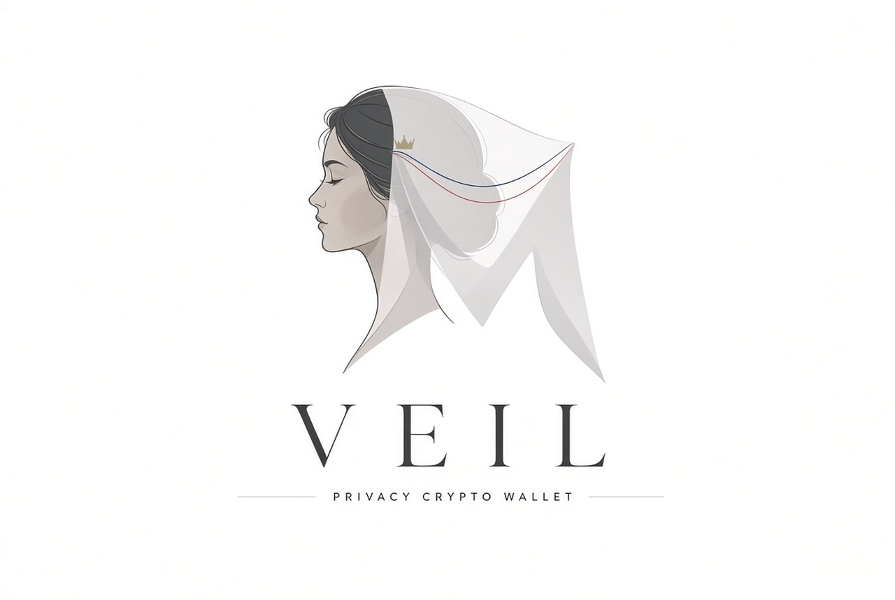

# Veil design

The visual language comes from the logo: a profile under a veil, drawn in
charcoal on a milk-white ground, with two thin threads (navy and crimson) and
a small gold crown.

## Principles

- **One main action per screen.** Home has the balance and two buttons.
  Everything else lives in the activity list and in Settings.
- **Status in words.** Tor and sync state are always visible and always
  written out ("Tor connected", "Syncing, N blocks left", "Ready"). Colour
  alone never carries meaning.
- **Addresses are made to be checked.** Monospaced, in groups of four
  characters, with the beginning and the end emphasised.
- **No decoration.** No illustrations inside the app apart from the logo, no
  gradients, no animation except progress.
- **One layout everywhere.** Desktop uses the same single column as the
  phone, in a narrow window.

## Colour

| Token | Value | Use |
|---|---|---|
| Ground | `#FDFDFB` | Screen background |
| Surface | `#F4F3EF` | Address blocks, notices |
| Field | `#FFFFFF` | Input fields, QR code background |
| Ink | `#2F3033` | Text, primary button |
| Muted | `#66676B` | Secondary text |
| Hairline | `#E4E2DD` | Dividers |
| Field border | `#8A8B8F` | Input outlines |
| Thread navy | `#2C3E6B` | Incoming amounts |
| Thread crimson | `#A3324A` | Outgoing amounts, warnings |
| Gold | `#B08D4C` | Small decorative marks only, never text |

Navy and crimson are the two threads of the veil in the logo. Incoming and
outgoing amounts also carry a plus or minus sign and a label, so they can be
told apart without colour.

The light theme is the default. A dark theme is available in Settings.

## Type

| Role | Typeface | Use |
|---|---|---|
| Display | Cormorant Garamond | Screen titles, the balance, amounts |
| Interface | Jost | Labels, buttons, body text |
| Monospace | JetBrains Mono | Addresses, word numbers |

Screen titles and button labels are uppercase with wide letter spacing, as
in the logo's wordmark. Numbers use lining, tabular figures.

All three typefaces cover Latin and Cyrillic and are licensed under the SIL
Open Font License. They are bundled with the app; nothing is fetched at
runtime.

## Controls

- Buttons are 54 px high with a 2 px corner radius. The primary button is
  filled with Ink; the secondary button is outlined.
- Every touch target is at least 44 px.
- Body text contrast is at least 4.5:1 against its background.

## Screens

1. **Start.** Logo, Create wallet, Restore from recovery phrase. Restore
   opens a form for the phrase and, for 25-word phrases, the creation date.
2. **Recovery phrase.** Sixteen numbered words, a warning, and a
   confirmation button. Followed by a check of three words.
3. **Home.** Balance (tap to hide), available and pending amounts, Tor and
   sync status, Receive and Send, recent activity.
4. **Receive.** QR code, the number of the address, the address itself, Copy
   and Share.
5. **Send.** Form, then a review screen, then a confirmation.
6. **Settings.** Tor status, node, bridges, password, auto-lock, show
   recovery phrase, theme, language.

## Language

The interface ships in English and Russian. By default it follows the device
language and falls back to English.

## To do

- A vector version of the logo. The repository currently has a raster image,
  whose white background shows as a faint box on the start screen.
- A simplified mark for the app icon. The full illustration does not read at
  icon size.
